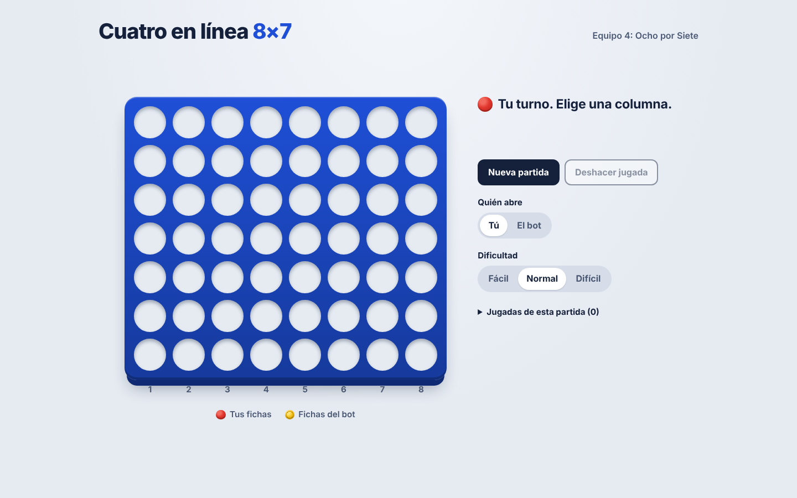
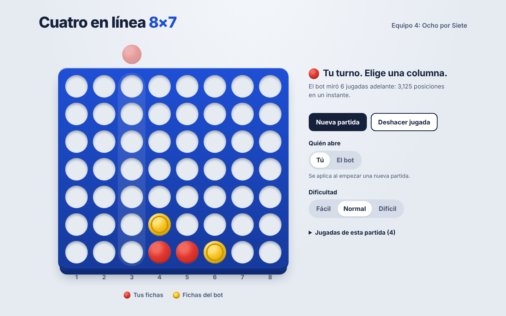
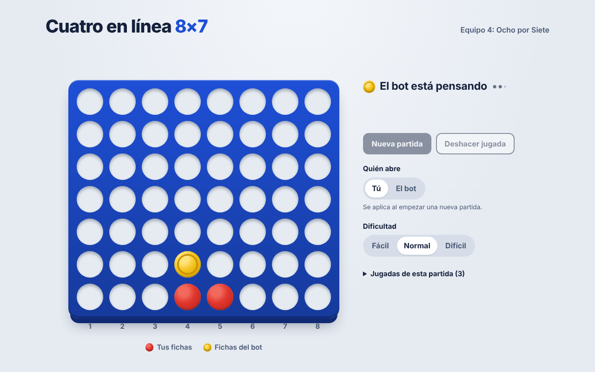
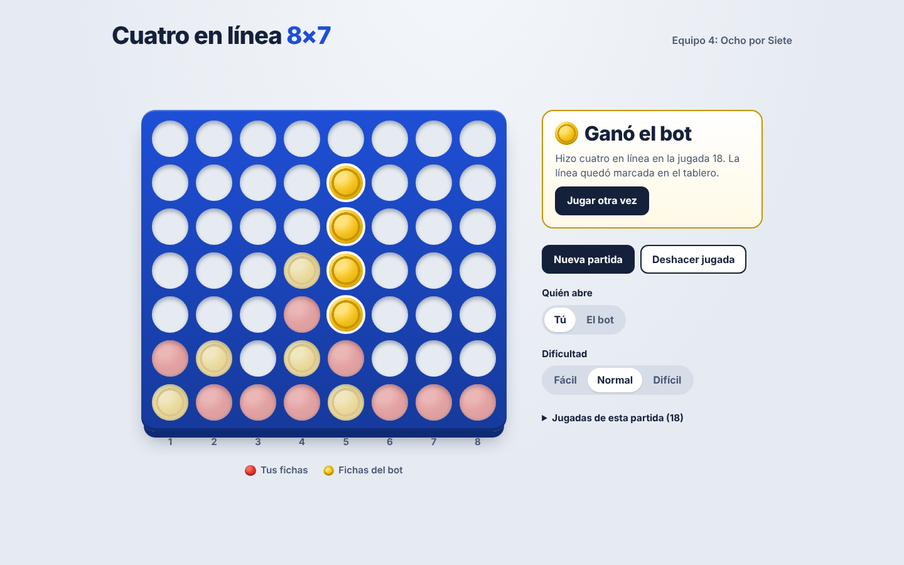
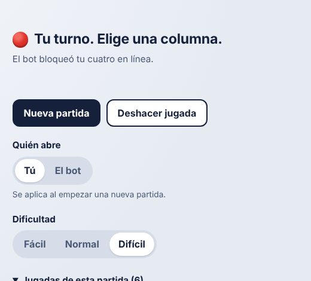
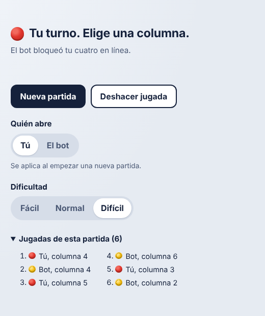
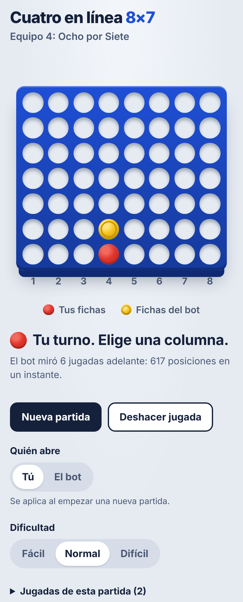
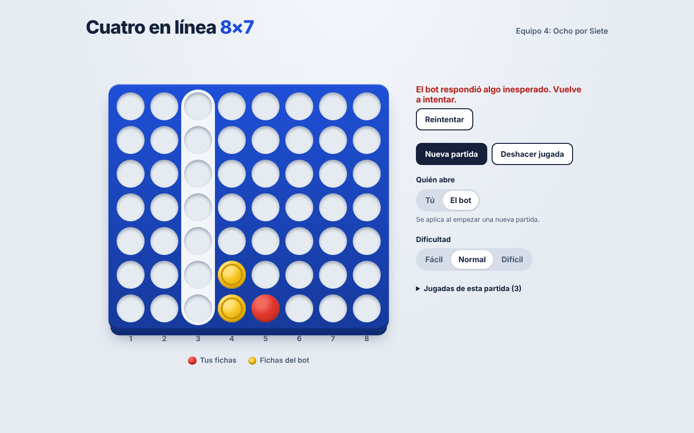

# Manual de uso: Cuatro en línea 8×7

Esta aplicación te deja jugar Cuatro en línea contra el bot del Equipo 4 (Ocho por Siete). Es el mismo bot que compite en el torneo: piensa igual, con el mismo algoritmo.

No necesitas saber programar para usarla. Solo necesitas un navegador (Chrome, Safari, Edge o Firefox).

## Cómo abrir la aplicación

Alguien del equipo deja la aplicación corriendo en su laptop. Cuando está lista, tú solo abres una dirección en el navegador:

- **En la misma laptop:** abre **http://localhost:5173**.
- **En tu teléfono o en otra computadora:** conéctate a la **misma red Wi-Fi** que la laptop y abre la dirección que te dé esa persona. Se ve así: `http://192.168.1.25:5173` (los números cambian según la red).

Al abrirla, la partida empieza sola y te toca a ti.

> Si eres quien la deja corriendo: en la carpeta del proyecto, abre dos terminales y escribe `npm run api` en una y `npm run web` en la otra. La segunda muestra las direcciones bajo `Local:` y `Network:`; la de `Network:` es la que se comparte para el teléfono. Detalles en el [README](../README.md).

## La pantalla

| Parte | Qué es |
|---|---|
| **Tablero azul** | 8 columnas y 7 filas. Las columnas están numeradas del 1 al 8 debajo del tablero. |
| **Fichas rojas** | Las tuyas. Son lisas. |
| **Fichas amarillas** | Las del bot. Tienen un anillo en el centro (así se distinguen aunque cueste ver los colores). |
| **Mensaje a la derecha** | Te dice de quién es el turno y qué pasó. |
| **Botones y opciones** | Empezar de nuevo, deshacer, elegir quién empieza y la dificultad. |
| **Jugadas de esta partida** | La lista de todas las jugadas (se abre con un clic). |

## Cómo se juega

**El objetivo:** ser el primero en juntar **cuatro fichas tuyas seguidas**, en línea recta: de lado (horizontal), de arriba abajo (vertical) o en diagonal.

1. **Elige una columna.** Cuando el mensaje dice **"Tu turno. Elige una columna."**, haz clic en cualquier parte de la columna donde quieras jugar. En el teléfono, tócala.
2. **Tu ficha cae.** Las fichas caen hasta el espacio libre más bajo de esa columna, como en el juego de mesa. Antes de hacer clic, al pasar el mouse por una columna ves una ficha roja clarita arriba: ahí es donde vas a jugar.
3. **El bot responde.** El mensaje cambia a **"El bot está pensando"**. Mientras tanto no puedes jugar. En un momento cae su ficha amarilla y vuelve a ser tu turno.
4. **Repite** hasta que alguien haga cuatro en línea o se llene el tablero.

Debajo del mensaje "Tu turno", la aplicación a veces explica la última jugada del bot, por ejemplo: *"El bot bloqueó tu cuatro en línea"* o *"El bot miró 13 jugadas adelante: 1.4 millones de posiciones en 0.9 s"*. Es solo informativo.

### Columnas llenas

Una columna tiene espacio para 7 fichas. Cuando se llena, ya no puedes jugar ahí: al pasar el mouse, el cursor muestra que no está permitido y no pasa nada al hacer clic.

## Cómo termina una partida

- **Ganaste:** aparece **"¡Ganaste!"** y tus cuatro fichas ganadoras quedan marcadas con un borde blanco brillante. El resto de las fichas se ven más claras.
- **Ganó el bot:** aparece **"Ganó el bot"** y se marcan sus cuatro fichas.
- **Empate:** si se llenan las 56 casillas sin que nadie haga cuatro en línea, aparece **"Empate"**.

Para jugar de nuevo, presiona **Jugar otra vez**.

## Opciones

| Opción | Qué hace |
|---|---|
| **Nueva partida** | Empieza otra partida desde cero en cualquier momento. |
| **Deshacer jugada** | Quita tu última jugada (y la respuesta del bot) para que vuelvas a intentarlo. Está gris si todavía no has jugado. |
| **Quién abre: Tú / El bot** | Elige quién pone la primera ficha. Mientras todavía no hayas puesto ninguna ficha, el cambio es **inmediato**: si eliges "El bot", pone su primera ficha enseguida; si el bot ya abrió y eliges "Tú", empieza otra partida en la que abres tú. En cuanto haces tu primera jugada, esta opción queda **bloqueada** hasta que la partida termine o presiones "Nueva partida". |
| **Dificultad: Fácil / Normal / Difícil** | **Fácil:** el bot mira solo 2 jugadas adelante; se le puede ganar. **Normal:** mira hasta 6. **Difícil:** piensa hasta 1.5 segundos, igual que en el torneo; es muy difícil ganarle. Se puede cambiar mientras todavía no hayas puesto ninguna ficha o con la partida terminada; en cuanto haces tu primera jugada queda **bloqueada** hasta que empieces una nueva. |
| **Jugadas de esta partida** | Haz clic para ver la lista: quién jugó y en qué columna (del 1 al 8). |

## En el teléfono

La aplicación se acomoda a la pantalla: el tablero queda arriba y los mensajes y opciones debajo. Se juega tocando la columna.

## Jugar sin mouse (con el teclado)

1. Presiona **Tab** hasta que una columna quede marcada con un borde naranja.
2. Usa las flechas **←** y **→** para moverte entre columnas.
3. Presiona **Enter** para soltar la ficha.

Los mensajes también los leen los lectores de pantalla.

## Si algo sale mal

| Ves esto | Qué significa | Qué hacer |
|---|---|---|
| **"No hay conexión con el bot. Revisa que la API esté corriendo y vuelve a intentar."** con un botón **Reintentar** | La aplicación no logra hablar con el bot: la laptop que lo corre se apagó, se cerró una de las terminales o se perdió el Wi-Fi. | Pide a quien la tiene corriendo que revise que `npm run api` siga abierta. Luego presiona **Reintentar**: la partida sigue donde iba. |
| La página no carga | La aplicación no está corriendo o la dirección no es la correcta. | Revisa la dirección. En el teléfono, confirma que estás en el mismo Wi-Fi que la laptop. |
| No pasa nada al hacer clic | Es el turno del bot, la columna está llena o la partida ya terminó. | Mira el mensaje de la derecha: siempre dice qué está pasando. |

## Preguntas frecuentes

**¿Se puede ganarle al bot?**
En **Fácil**, sí. En **Difícil** es muy difícil: mira muchas jugadas adelante y nunca deja pasar un cuatro en línea que pueda bloquear.

**¿Por qué el tablero es de 8×7 y no de 7×6 como el juego de mesa?**
Así lo pide el reto: un tablero más ancho hace que no sirvan las soluciones ya conocidas para el tablero clásico.

**¿Se guardan las partidas?**
No. Cada partida vive solo mientras la página está abierta. Si recargas la página, empieza una nueva.

**¿Es el mismo bot del torneo?**
Sí. La aplicación usa exactamente el mismo algoritmo que juega contra los otros equipos. En **Difícil** piensa casi lo mismo que en el torneo (1.5 segundos aquí, 1.8 allá).
